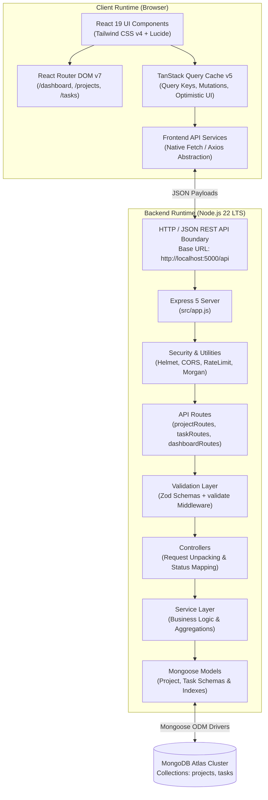

# Technology Stack and Engineering Standards
## SprintDesk — Project & Sprint Management Web Application

---

## 1. Technology Inventory

This inventory documents all existing and planned technologies across the SprintDesk platform based on verified repository files (`client/package.json`, `server/package.json`, configuration files, and active runtime environment).

| Technology | Category | Installed Version | Actual Status | Usage Location | Architectural Justification & Selection Rationale | Alternatives Evaluated |
| :--- | :--- | :--- | :--- | :--- | :--- | :--- |
| **Node.js** | Runtime Environment | `v22.14.0` (LTS) | Implemented | System runtime | Modern LTS runtime supporting native ECMAScript Modules (ESM), high-performance V8 engine, and native fetch. | Deno, Bun |
| **React** | Frontend UI Library | `^19.2.8` | Implemented | `client/` | Declarative component model, high rendering performance, rich ecosystem, and modern hooks. | Vue.js, Svelte |
| **React DOM** | DOM Renderer | `^19.2.8` | Implemented | `client/src/main.jsx` | Official DOM renderer for React 19 web applications. | N/A |
| **Vite** | Frontend Build Tool | `^8.3.0` (dev) | Implemented | `client/vite.config.js` | Ultra-fast Hot Module Replacement (HMR), lightning-fast ES module dev server, and optimized Rollup production bundling. | Webpack, Create React App |
| **JavaScript (ESM & JSX)** | Language Standard | ES2024 / JSX | Implemented | `client/`, `server/` | Native ES modules (`"type": "module"` in both package files) provide clean import/export semantics across frontend and backend. | TypeScript |
| **Tailwind CSS** | Utility-First CSS | `^4.3.3` (dev) | Partially Implemented | `client/` | Utility-first styling framework enabling rapid, responsive, and consistent SaaS UI design. Installed, but `@tailwindcss/vite` plugin registration in `vite.config.js` and `@import "tailwindcss";` in `src/index.css` remain to be completed. | Vanilla CSS, Sass, Styled-Components |
| **@tailwindcss/vite** | Vite Plugin | `^4.3.3` (dev) | Partially Implemented | `client/vite.config.js` | Native Vite integration plugin for Tailwind CSS v4 engine. Package installed; registration in `vite.config.js` planned in Phase 2. | PostCSS plugin |
| **React Router DOM** | Client Routing | `^7.18.4` | Implemented | `client/src/routes/` | Industry standard declarative client-side routing for React SPAs; provides nested route hierarchies and URL parameter binding. | TanStack Router |
| **TanStack React Query** | Server State Management | `^5.104.1` | Implemented | `client/src/hooks/` | Robust server state synchronization, query caching, background refetching, mutation lifecycle handling, and optimistic updates. | Redux Toolkit, SWR, Zustand |
| **Lucide React** | UI Icon System | `^1.55.0` | Implemented | `client/src/components/` | Crisp, scalable, tree-shakeable SVG icons adhering to modern SaaS design guidelines. | Heroicons, FontAwesome |
| **Recharts** | Data Visualization | `^3.10.1` | Implemented | `client/src/components/dashboard/` | Composable, declarative charting library built specifically for React; ideal for sprint status distribution and velocity metrics. | Chart.js, Tremor |
| **Express.js** | Backend Web Framework | `^5.3.0` | Implemented | `server/src/app.js` | Minimalist, fast HTTP server framework for Node.js, providing robust middleware pipelines and REST routing. | Fastify, NestJS, Koa |
| **MongoDB Atlas** | Database | Cloud v7.x/v8.x | Planned | Cloud Database | Flexible document database ideal for JSON-centric hierarchical sprint models (projects containing task arrays/references). | PostgreSQL, MySQL |
| **Mongoose** | Object Data Modeling (ODM) | `^9.11.1` | Implemented | `server/src/models/` | Type-safe schema validation, model lifecycle hooks, query middleware, and population helpers for MongoDB. | Native MongoDB Driver, Prisma |
| **dotenv** | Environment Management | `^18.0.7` | Implemented | `server/src/config/` | Loads environment variables from `.env` files into `process.env` safely. | Built-in Node `--env-file` |
| **CORS** | HTTP Middleware | `^2.8.6` | Implemented | `server/src/middleware/` | Enforces Cross-Origin Resource Sharing security by restricting API access strictly to designated client origins. | Custom headers middleware |
| **Helmet** | HTTP Security Headers | `^8.3.0` | Implemented | `server/src/middleware/` | Sets critical HTTP response headers (CSP, HSTS, X-Frame-Options) to protect against common web vulnerabilities. | Custom security headers |
| **Morgan** | HTTP Request Logger | `^1.12.1` | Implemented | `server/src/middleware/` | Standardized HTTP request logging for development inspection and operational monitoring. | Pino, Winston |
| **express-rate-limit** | Rate Limiting | `^8.7.1` | Implemented | `server/src/middleware/` | Protects endpoints against denial-of-service (DoS) and brute-force attacks via sliding window rate limiting. | Redis rate limiter |
| **Zod** | Schema & Request Validation | `^4.6.5` | Implemented | `server/src/validators/` | TypeScript/JavaScript first schema declaration and runtime data parsing with clear, actionable validation error reporting. | Joi, Yup |
| **Nodemon** | Dev Process Monitor | `^3.1.14` (dev) | Implemented | `server/package.json` | Automatically restarts the Node server process upon detecting source file changes during development. | ts-node-dev, native Node `--watch` |
| **ESLint** | Code Quality & Linter | `^10.10.0` (dev) | Implemented | `client/eslint.config.js` | Static code analysis enforcing idiomatic React hooks usage, modern syntax, and clean code standards. | Biome |
| **Vitest & Supertest** | Testing Suite | Planned | Proposed | `tests/` | Modern unit and integration testing suite for Vite/React and Express REST endpoints. | Jest, Mocha/Chai |

---

## 2. Architecture Overview

SprintDesk utilizes a decoupled **Client-Server Architecture** adhering to RESTful communication protocols. The system is split across two core packages:
1. **Frontend Client (`client/`)**: A single-page application (SPA) executing in the browser, powered by React 19 and Vite. Server communication is governed by TanStack Query, decoupling asynchronous network operations from UI rendering.
2. **Backend Server (`server/`)**: A stateless REST API server built on Express 5 running on Node 22 LTS. It processes HTTP requests through a structured layered pipeline (Security $\rightarrow$ Route $\rightarrow$ Validation $\rightarrow$ Controller $\rightarrow$ Service $\rightarrow$ Mongoose Model $\rightarrow$ MongoDB Atlas).

### 2.1 Component Architecture Diagram



### 2.2 Boundary Responsibilities

| Architectural Boundary | Primary Responsibilities | Data Formats | Failure Modes & Safeguards |
| :--- | :--- | :--- | :--- |
| **Client UI $\rightarrow$ Cache** | View rendering, user interactions, local state, form input collection. | React Props, State, JSX | Error Boundaries prevent white screens; fallback loading skeletons prevent layout shift. |
| **Cache $\rightarrow$ HTTP Boundary** | Caching, deduplication, background revalidation, optimistic mutation handling. | JavaScript Objects $\rightarrow$ JSON | Automatic retry with exponential backoff on network failure; error toast notifications. |
| **HTTP $\rightarrow$ Express Pipeline** | TLS termination, rate limit enforcement, CORS policy verification, security headers. | HTTP Headers & Raw JSON Streams | Rate limit returns `429 Too Many Requests`; invalid CORS returns `403 Forbidden`. |
| **Validation Layer** | Structural schema verification, type coercion, string trimming, enum checking. | Parsed JSON Objects | Fails early with `400 Bad Request` and structured field error array before reaching controllers. |
| **Controller $\rightarrow$ Service** | Decoupling HTTP transport concerns (req/res) from business rules and queries. | Clean DTOs / Method Parameters | Uncaught exceptions intercepted by centralized `errorHandler` returning `500 Internal Server Error`. |
| **Service $\rightarrow$ Mongoose Models** | Relational integrity enforcement, cascade deletions, aggregations, queries. | Mongoose Documents / Lean Objects | Referential constraint checks; database connection retry mechanisms. |

---

## 3. Repository Structure

### 3.1 Existing vs. Planned Structure

```
SprintDesk/
├── .git/                                 # [Implemented] Git repository metadata
├── .gitignore                            # [Implemented] Ignore rules for node_modules, env, build artifacts
├── docs/                                 # [Implemented] Comprehensive engineering specifications
│   ├── 01-SRS.md
│   ├── 02-TECH-STACK.md
│   ├── 03-UI-UX-DESIGN.md
│   ├── 04-END-TO-END-IMPLEMENTATION.md
│   ├── 05-API-DOCUMENTATION.md
│   └── 06-DATABASE-DESIGN.md
├── README.md                             # [Planned] Root project documentation and quickstart
├── client/                               # [Implemented] Frontend Vite + React application
│   ├── public/                           # [Implemented] Static assets (icons.svg, favicon.svg)
│   ├── src/                              # [Partially Implemented] Source code
│   │   ├── assets/                       # [Implemented] Default Vite starter images
│   │   ├── components/                   # [Planned] Modular React UI components
│   │   │   ├── common/                   # [Planned] Button, Input, Modal, Badge, Toast, Skeleton, EmptyState
│   │   │   ├── layout/                   # [Planned] AppShell, Sidebar, Topbar
│   │   │   ├── projects/                 # [Planned] ProjectCard, ProjectFormModal, ProjectHeader
│   │   │   ├── tasks/                    # [Planned] TaskTable, KanbanBoard, TaskCard, TaskFormModal, TaskStatusBadge
│   │   │   └── dashboard/                # [Planned] StatCard, ProgressChart, RecentTasks
│   │   ├── context/                      # [Planned] ToastContext, ModalContext
│   │   ├── hooks/                        # [Planned] Custom hooks (useProjects, useTasks, useDashboard, useDebounce)
│   │   ├── pages/                        # [Planned] DashboardPage, ProjectsPage, ProjectDetailsPage, TasksPage, NotFoundPage
│   │   ├── routes/                       # [Planned] AppRoutes.jsx router definitions
│   │   ├── services/                     # [Planned] api.js, projectService.js, taskService.js, dashboardService.js
│   │   ├── utils/                        # [Planned] formatters.js, constants.js, validators.js
│   │   ├── App.css                       # [Implemented] Starter CSS (to be replaced with design tokens)
│   │   ├── App.jsx                       # [Implemented] Starter App (to be replaced with AppShell and routing)
│   │   ├── index.css                     # [Implemented] Global CSS (to receive Tailwind directives)
│   │   └── main.jsx                      # [Implemented] React root render entry point
│   ├── eslint.config.js                  # [Implemented] ESLint configuration
│   ├── index.html                        # [Implemented] Single-page HTML shell
│   ├── package-lock.json                 # [Implemented] Client dependencies lockfile
│   ├── package.json                      # [Implemented] Client dependencies and scripts
│   └── vite.config.js                    # [Implemented] Vite build configuration (plugin setup pending)
└── server/                               # [Partially Implemented] Express REST API backend
    ├── src/                              # [Partially Implemented] Server source directory
    │   ├── config/                       # [Implemented Dir / Empty] db.js, env.js planned
    │   ├── controllers/                  # [Implemented Dir / Empty] projectController, taskController, dashboardController planned
    │   ├── middleware/                   # [Implemented Dir / Empty] errorHandler, validate, rateLimiter planned
    │   ├── models/                       # [Implemented Dir / Empty] Project.js, Task.js planned
    │   ├── routes/                       # [Implemented Dir / Empty] projectRoutes, taskRoutes, dashboardRoutes planned
    │   ├── services/                     # [Implemented Dir / Empty] projectService, taskService, dashboardService planned
    │   ├── utils/                        # [Implemented Dir / Empty] apiError.js, apiResponse.js, logger.js planned
    │   ├── validators/                   # [Implemented Dir / Empty] projectValidator.js, taskValidator.js planned
    │   ├── app.js                        # [Planned] Express application setup, middleware configuration
    │   └── server.js                     # [Planned] Server bootstrapper, MongoDB connection, process listeners
    ├── package-lock.json                 # [Implemented] Server dependencies lockfile
    └── package.json                      # [Implemented] Server dependencies and start scripts
```

---

## 4. Coding Conventions and Engineering Standards

### 4.1 Naming Conventions
- **Files and Folders**:
  - React Components: PascalCase (e.g., `ProjectCard.jsx`, `TaskTable.jsx`).
  - Hooks: camelCase starting with `use` (e.g., `useProjects.js`, `useDebounce.js`).
  - Utility and Service Files: camelCase (e.g., `projectService.js`, `formatters.js`).
  - Express Controllers, Routes, Middleware: camelCase (e.g., `projectController.js`, `errorHandler.js`).
  - Mongoose Models: PascalCase singular (e.g., `Project.js`, `Task.js`).
  - Documentation: UPPER_SNAKE_CASE with numerical prefix (e.g., `01-SRS.md`).
- **Variables and Functions**:
  - Variables, functions, methods: `camelCase` (e.g., `calculateProjectProgress()`, `taskCount`).
  - Constants and Enums: `UPPER_SNAKE_CASE` (e.g., `TASK_STATUSES`, `DEFAULT_PAGE_LIMIT`).
  - React Component Names: `PascalCase` (e.g., `StatCard`).
  - Database Field Names: `camelCase` (e.g., `projectId`, `completedAt`, `dueDate`).

### 4.2 Module System & Imports
- **Native ECMAScript Modules (ESM)**: Both `client/package.json` and `server/package.json` enforce `"type": "module"`. All imports must utilize standard `import / export` syntax. CommonJS `require()` is prohibited.
- **Import Ordering Convention**:
  ```javascript
  // 1. External third-party libraries
  import { useState, useEffect } from 'react';
  import { useQuery } from '@tanstack/react-query';
  import { CheckCircle2, AlertTriangle } from 'lucide-react';

  // 2. Internal services, hooks, and contexts
  import { useProjects } from '../../hooks/useProjects';
  import { useToast } from '../../context/ToastContext';

  // 3. Child UI components
  import Badge from '../common/Badge';
  import Modal from '../common/Modal';

  // 4. Utilities, constants, and styles
  import { formatDate } from '../../utils/formatters';
  import { TASK_STATUS } from '../../utils/constants';
  ```

### 4.3 React Component Conventions
1. **Functional Components Only**: Class components are forbidden. All components must be written as clean arrow or named functions.
2. **Props Destructuring & Validation**: Destructure props directly in function parameters with sensible default values where applicable.
3. **Component Sizing Rule**: No single component file should exceed $250$ lines of code. Sub-views, tables, and modal contents must be decomposed into focused sub-components.
4. **Custom Hooks for State Logic**: Data fetching, caching, and mutation orchestration must reside in dedicated custom hooks (`useProjects`, `useTasks`), keeping JSX view components purely presentational.

### 4.4 Express Controller and Service Responsibilities
1. **Controllers are Thin**: Controllers must only:
   - Extract parameters (`req.params`, `req.query`, `req.body`).
   - Call the corresponding service method.
   - Return formatted JSON responses with explicit HTTP status codes (`200`, `201`, `204`).
2. **Services Contain Business Rules**: All business logic, queries, MongoDB aggregations, and cascade deletion sequences reside in the service layer. Controllers never make direct Mongoose calls.
3. **No Duplicated Business Logic**: Calculations such as project progress or overdue status determination are written once in a shared utility/service function and reused across all routes and background tasks.

### 4.5 Centralized Error Handling Pattern
The server implements a custom `ApiError` class extending `Error`, carrying an HTTP status code, error code string, and optional validation details.

```javascript
// server/src/utils/apiError.js
export class ApiError extends Error {
  constructor(statusCode, message, code = 'INTERNAL_ERROR', details = null) {
    super(message);
    this.statusCode = statusCode;
    this.code = code;
    this.details = details;
    Error.captureStackTrace(this, this.constructor);
  }
}
```

All route handlers are wrapped using an asynchronous handler wrapper or Express 5 native async error propagation, feeding directly into the centralized error middleware.

---

## 5. Dependency Management

### 5.1 Lockfile Discipline
- `package-lock.json` must be checked into version control for both `client/` and `server/`.
- Dependency additions must use `npm install --save` or `npm install --save-dev` to maintain synchronization between `package.json` and the lockfile.
- No extraneous or unvetted dependencies are permitted. Libraries must be audited for security vulnerabilities (`npm audit`) before adoption.

### 5.2 Production Footprint Optimization
- Unused starter templates, images, and unreferenced packages must be removed prior to final assessment delivery.
- Tree-shaking is preserved by importing only required icons from `lucide-react` (e.g., `import { Check } from 'lucide-react'`).

---

## 6. Environment Configuration

### 6.1 Server Environment Variables (`server/.env.example`)
Real credentials must never be committed to Git. A sanitized `.env.example` file guides environment configuration.

```ini
# Server Network Configuration
PORT=5000
NODE_ENV=development

# Allowed Frontend Client Origin
CLIENT_URL=http://localhost:5173

# MongoDB Connection String (Atlas or Local)
MONGODB_URI=mongodb+srv://<username>:<password>@cluster0.mongodb.net/sprintdesk?retryWrites=true&w=majority

# Rate Limiting Configuration
RATE_LIMIT_WINDOW_MS=900000
RATE_LIMIT_MAX_REQUESTS=100

# Future Phase 12 Authentication Configuration (Planned)
JWT_SECRET=your_super_secret_jwt_key_min_32_characters_here
JWT_EXPIRES_IN=7d
```

### 6.2 Client Environment Configuration (`client/.env.example`)
```ini
# Vite API Base URL
VITE_API_BASE_URL=http://localhost:5000/api
```

---

## 7. Security Standards

1. **Input Validation & Sanitization**: All request bodies and query parameters pass through strict Zod schemas before controller invocation. Invalid keys are stripped or rejected.
2. **HTTP Headers via Helmet**: Helmet enables Content Security Policy (CSP), hides `X-Powered-By: Express`, and enforces HTTPS framing constraints.
3. **CORS Restrictions**: Origin whitelist strictly checks `req.header('Origin')` against `CLIENT_URL`. Disallows wildcard `*` in production mode.
4. **Rate Limiting**: `express-rate-limit` prevents brute-force or denial-of-service spam on all `/api/` routes ($100$ requests per $15$ minutes per IP).
5. **NoSQL Injection Prevention**: Mongoose models enforce strict types. Client input is never passed directly to dynamic query operators (e.g., `$where`, `$regex` without escaping).
6. **Information Disclosure Prevention**: Error responses in production (`NODE_ENV === 'production'`) sanitize internal system messages and omit stack traces.

---

## 8. Development Commands and Scripts

### 8.1 Client Scripts (`client/package.json`)
- `npm run dev --prefix client`: Launches Vite development server on `http://localhost:5173` with instant HMR.
- `npm run build --prefix client`: Executes Vite production build, outputting minified bundles to `client/dist/`.
- `npm run preview --prefix client`: Serves production build locally for verification.
- `npm run lint --prefix client`: Runs ESLint across client JavaScript/JSX files.

### 8.2 Server Scripts (`server/package.json`)
- `npm run dev --prefix server`: Boots Express server with `nodemon src/server.js` for auto-reloading on save.
- `npm start --prefix server`: Boots Express production server with standard `node src/server.js`.
- `npm test --prefix server`: Currently configured to exit with error until the test suite is configured in Phase 11.

### 8.3 Git & Workspace Verification
- `git status`: Verifies repository clean state and uncommitted changes.
- `git log -n 5`: Inspects recent commit history.
