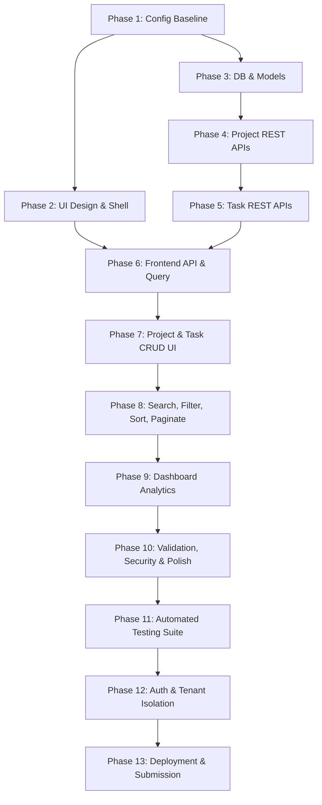

# End-to-End Implementation Plan & Architecture Guide
## SprintDesk — Project & Sprint Management Web Application

---

## 1. Current Implementation Audit

This audit reflects verified source code findings within `d:\SprintDesk` following a complete repository inspection.

| Feature / Artifact | Category | Status | Verified Evidence & Current State |
| :--- | :--- | :--- | :--- |
| **Root Git & Config** | Configuration | Implemented | Clean repository on branch `main`, 1 commit (`7f75a55`). `.gitignore` properly excludes `node_modules`, `.env`, and build outputs. |
| **Client Package Config** | Frontend Scaffolding | Implemented | `client/package.json` specifies React 19.2.8, Vite 8.3.0, TanStack Query 5.104.1, Lucide React 1.55.0, React Router DOM 7.18.4, Recharts 3.10.1, Tailwind CSS 4.3.3. |
| **Client Source Tree** | Frontend Scaffolding | Partially Implemented | Default starter template active (`App.jsx` contains Vite counter demo). No SprintDesk custom components, layouts, or pages exist. |
| **Client Tailwind Setup** | Frontend Styling | Partially Implemented | `tailwindcss` and `@tailwindcss/vite` installed in `package.json`, but plugin not registered in `vite.config.js` and `index.css` lacks Tailwind directives. |
| **Client Production Build** | Frontend Tooling | Implemented | `npm run build --prefix client` verified successfully (produces valid production bundle in `dist/`). |
| **Server Package Config** | Backend Scaffolding | Implemented | `server/package.json` specifies Node ESM (`"type": "module"`), Express 5.3.0, Mongoose 9.11.1, Zod 4.6.5, Helmet 8.3.0, Morgan 1.12.1, CORS 2.8.6, Rate Limit 8.7.1, Nodemon 3.1.14. |
| **Server Source Tree** | Backend Architecture | Partially Implemented | Subdirectories exist (`config`, `controllers`, `middleware`, `models`, `routes`, `services`, `utils`, `validators`), but all are empty. Entry point `src/server.js` and `src/app.js` are missing. |
| **MongoDB Connection** | Database Layer | Planned | No Mongoose connection script or `.env` configuration file currently exists. |
| **Mongoose Models** | Database Models | Planned | Neither `Project.js` nor `Task.js` models exist yet. |
| **Project & Task REST APIs**| API Layer | Planned | No routes, controllers, or validators exist in `server/src/`. |
| **Automated Test Suite** | Quality Assurance | Planned | No test framework installed. `npm test --prefix server` exits with placeholder error code 1. |
| **User Authentication** | Security / Auth | Planned (Phase 12)| Deferred to Phase 12; single-workspace mode active for primary assessment. |

---

## 2. End-to-End Architecture & Request Lifecycle

SprintDesk follows a deterministic, unidirectional data flow that separates presentation, state caching, transport, business rules, and database persistence.

### 2.1 Complete Request-to-Database Lifecycle Diagram

```mermaid
sequenceDiagram
    autonumber
    actor User as User Interaction
    participant View as React Component
    participant Hook as Custom Hook / TanStack Query
    participant Service as Frontend API Service
    participant HTTP as Network / Express Server
    participant Mid as Express Middleware (CORS/Helmet/RateLimit)
    participant Val as Zod Validator Middleware
    participant Ctrl as Express Controller
    participant Svc as Backend Business Service
    participant Model as Mongoose Model
    participant DB as MongoDB Atlas

    User->>View: Clicks "Create Project" / "Update Status"
    View->>Hook: Triggers mutation handler
    Note over Hook: Optimistic update applied to cache (if applicable)
    Hook->>Service: Calls service function (e.g., projectService.create)
    Service->>HTTP: Dispatches HTTP fetch request (POST/PATCH/GET/DELETE)
    HTTP->>Mid: Evaluates security, CORS, rate limits, request logs
    Mid->>Val: Parses body/params against Zod schema
    alt Validation Failure
        Val-->>HTTP: Returns 400 Bad Request with field errors
        HTTP-->>Service: Rejects with error payload
        Service-->>Hook: Triggers mutation onError
        Hook-->>View: Rolls back cache; renders form error / toast
    else Validation Success
        Val->>Ctrl: Forwards sanitized payload to controller
        Ctrl->>Svc: Dispatches business operation
        Svc->>Model: Queries / mutates via Mongoose ODM
        Model->>DB: Executes MongoDB query / aggregation
        DB-->>Model: Returns document / result set
        Model-->>Svc: Hydrates documents / lean objects
        Svc-->>Ctrl: Returns formatted business DTO
        Ctrl-->>HTTP: Sends HTTP response (200/201/204) with JSON envelope
        HTTP-->>Service: Receives HTTP response
        Service-->>Hook: Resolves mutation / query promise
        Hook-->>View: Commits cache update; triggers re-render
        View-->>User: Displays updated UI and success toast notification
    end
```

### 2.2 Lifecycle Variations by Operation Type
1. **Read Requests (`GET`)**: Bypass request body validation; query parameters pass through schema sanitization; TanStack Query checks cache first; serves stale data while revalidating in background if configured.
2. **Create Requests (`POST`)**: Strict Zod payload validation; server generates MongoDB `_id` and timestamps; TanStack Query invalidates parent query keys upon `201 Created`, triggering a background refetch.
3. **Update Requests (`PATCH`)**: Zod validates partial payload; atomic Mongoose update (`findByIdAndUpdate` with `{ runValidators: true, new: true }`); optimistic UI updates apply instantly and rollback if the network call rejects.
4. **Delete Requests (`DELETE`)**: Express checks ID format; backend executes cascade deletion of associated child tasks; TanStack Query removes deleted record from cache; UI displays confirmation toast.
5. **Error Flows**: All rejected promises in Express bubble to `errorHandler` middleware; HTTP response sets `{ success: false, error: { code, message, details } }`; client extracts error message and renders inline field errors or toast.

---

## 3. Dependency-Aware Implementation Phases



---

## 4. Detailed Implementation Phases

### Phase 1: Repository and Configuration Baseline
- **Objective**: Establish operational backend entry points, environment variables, and client Tailwind configuration.
- **Prerequisites**: Node.js and NPM installed.
- **Files to Inspect**: `server/package.json`, `client/vite.config.js`, `client/src/index.css`.
- **Files to Create or Modify**:
  - `server/.env.example`
  - `server/src/config/env.js`
  - `server/src/app.js`
  - `server/src/server.js`
  - `client/vite.config.js`
  - `client/src/index.css`
- **Implementation Tasks**:
  1. Create `server/src/app.js` configuring Express, `cors()`, `helmet()`, `morgan()`, and `express.json()`.
  2. Implement health check route `GET /api/health`.
  3. Create `server/src/server.js` to listen on `process.env.PORT || 5000`.
  4. Update `client/vite.config.js` to register `@tailwindcss/vite`.
  5. Add `@import "tailwindcss";` to `client/src/index.css`.
- **Edge Cases**: Missing `.env` file should fall back to sensible defaults with console warning.
- **Security Considerations**: Ensure `server/.env` is never committed; verify `.gitignore`.
- **Tests**: Run `curl http://localhost:5000/api/health` and verify `200 OK`.
- **Acceptance Criteria**: Backend boots with `npm run dev --prefix server`; frontend builds with Tailwind support.
- **Completion Evidence**: Health endpoint responds with `{ status: "ok" }`.

---

### Phase 2: UI Design System and Application Layout
- **Objective**: Build the application shell with Dark Navy sidebar, Topbar, and responsive drawer.
- **Prerequisites**: Phase 1 completed.
- **Files to Inspect**: `client/src/App.jsx`, `client/src/main.jsx`.
- **Files to Create or Modify**:
  - `client/src/components/layout/Sidebar.jsx`
  - `client/src/components/layout/Topbar.jsx`
  - `client/src/components/layout/AppShell.jsx`
  - `client/src/routes/AppRoutes.jsx`
  - `client/src/pages/DashboardPage.jsx`
  - `client/src/pages/ProjectsPage.jsx`
  - `client/src/pages/TasksPage.jsx`
  - `client/src/pages/NotFoundPage.jsx`
- **Implementation Tasks**:
  1. Build persistent `Sidebar` with links for Dashboard, Projects, Tasks.
  2. Build `Topbar` with global search input, quick "+ New Task" button, and mobile hamburger trigger.
  3. Assemble `AppShell` with responsive off-canvas mobile drawer.
  4. Configure `React Router DOM` routes in `AppRoutes.jsx`.
- **Edge Cases**: Mobile viewport resizing without drawer glitching; active route highlight accuracy.
- **Security Considerations**: Sanitize URL route parameters against malicious script injections.
- **Tests**: Manually navigate across `/`, `/projects`, `/tasks`, `/404`.
- **Acceptance Criteria**: App shell renders without layout shifts across desktop, tablet, and mobile breakpoints.
- **Completion Evidence**: Screenshot and DOM verification of AppShell navigation.

---

### Phase 3: MongoDB Connection and Mongoose Models
- **Objective**: Establish MongoDB connection and define `Project` and `Task` Mongoose models with referential integrity.
- **Prerequisites**: MongoDB Atlas connection URI or local MongoDB instance.
- **Files to Inspect**: `server/src/config/env.js`.
- **Files to Create or Modify**:
  - `server/src/config/db.js`
  - `server/src/models/Project.js`
  - `server/src/models/Task.js`
- **Implementation Tasks**:
  1. Implement `connectDB()` in `server/src/config/db.js` with auto-reconnect listeners.
  2. Define `Project` schema: `name`, `description`, `status`, `color`, `startDate`, `dueDate`, `timestamps`.
  3. Define `Task` schema: `title`, `description`, `projectId` (ObjectId ref), `status`, `priority`, `assignee`, `labels`, `dueDate`, `completedAt`, `timestamps`.
  4. Add indexes: `Task.schema.index({ projectId: 1, status: 1 })`.
- **Edge Cases**: Database disconnection handles error gracefully without terminating server process.
- **Security Considerations**: Strip invalid query operators.
- **Tests**: Connect to database; verify model compilation and index registration.
- **Acceptance Criteria**: Mongoose connects cleanly; schemas enforce field types and enum restrictions.
- **Completion Evidence**: Console logs `"MongoDB Connected Successfully"`.

---

### Phase 4: Project REST APIs
- **Objective**: Implement complete CRUD endpoints for Projects with Zod validation.
- **Prerequisites**: Phase 3 completed.
- **Files to Create or Modify**:
  - `server/src/validators/projectValidator.js`
  - `server/src/services/projectService.js`
  - `server/src/controllers/projectController.js`
  - `server/src/routes/projectRoutes.js`
  - `server/src/middleware/validate.js`
  - `server/src/middleware/errorHandler.js`
- **Implementation Tasks**:
  1. Create Zod schemas for project creation and updates.
  2. Implement `GET /api/projects`, `POST /api/projects`, `GET /api/projects/:id`, `PATCH /api/projects/:id`, `DELETE /api/projects/:id`.
  3. Implement cascade task deletion in `projectService.deleteProject`.
- **Edge Cases**: Attempting to fetch or update non-existent ID returns `404`; malformed ObjectId returns `400`.
- **Security Considerations**: Validate all inputs; sanitize strings.
- **Tests**: Execute curl / API test requests for all 5 endpoints.
- **Acceptance Criteria**: All project CRUD operations return valid status codes (`200`, `201`, `400`, `404`).
- **Completion Evidence**: Verified JSON responses matching API contracts.

---

### Phase 5: Task REST APIs and Project Relationships
- **Objective**: Implement Task CRUD endpoints, status transitions, and relational enforcement.
- **Prerequisites**: Phase 4 completed.
- **Files to Create or Modify**:
  - `server/src/validators/taskValidator.js`
  - `server/src/services/taskService.js`
  - `server/src/controllers/taskController.js`
  - `server/src/routes/taskRoutes.js`
- **Implementation Tasks**:
  1. Create Zod schemas for task creation and updates.
  2. Implement `GET /api/tasks` (with `projectId`, `status`, `priority` filters), `POST /api/tasks`, `GET /api/tasks/:id`, `PATCH /api/tasks/:id`, `DELETE /api/tasks/:id`.
  3. Enforce that `projectId` exists before creating task; auto-set `completedAt` when status is `done`.
- **Edge Cases**: Creating task with non-existent `projectId` fails with `404 Project not found`.
- **Security Considerations**: Prevent unauthorized reassignment of project references.
- **Tests**: Test task lifecycle: create $\rightarrow$ update status to done $\rightarrow$ verify `completedAt` timestamp.
- **Acceptance Criteria**: All task routes operational with relational checks.
- **Completion Evidence**: Verified API responses for task operations.

---

### Phase 6: Frontend API Services and TanStack Query Integration
- **Objective**: Build frontend API clients and custom query hooks for data synchronization.
- **Prerequisites**: Phases 4 and 5 completed.
- **Files to Create or Modify**:
  - `client/src/services/api.js`
  - `client/src/services/projectService.js`
  - `client/src/services/taskService.js`
  - `client/src/hooks/useProjects.js`
  - `client/src/hooks/useTasks.js`
  - `client/src/context/ToastContext.jsx`
- **Implementation Tasks**:
  1. Create unified HTTP client in `api.js` handling base URL, error parsing, and JSON serialization.
  2. Wrap API calls in custom hooks using `useQuery` and `useMutation`.
  3. Configure query key conventions: `['projects']`, `['project', id]`, `['tasks', filters]`.
  4. Implement `ToastContext` for feedback.
- **Edge Cases**: Server down gracefully caught and surfaced as toast error.
- **Security Considerations**: Sanitize error messages displayed to users.
- **Tests**: Verify hook states (`isLoading`, `isError`, `data`).
- **Acceptance Criteria**: Hooks fetch and cache data seamlessly.
- **Completion Evidence**: Successful cache population in React Query Devtools.

---

### Phase 7: Project and Task CRUD Workflows
- **Objective**: Build interactive UI components for creating, editing, and deleting projects and tasks.
- **Prerequisites**: Phase 6 completed.
- **Files to Create or Modify**:
  - `client/src/components/common/Modal.jsx`
  - `client/src/components/common/ConfirmDialog.jsx`
  - `client/src/components/projects/ProjectCard.jsx`
  - `client/src/components/projects/ProjectFormModal.jsx`
  - `client/src/components/tasks/TaskTable.jsx`
  - `client/src/components/tasks/TaskCard.jsx`
  - `client/src/components/tasks/KanbanBoard.jsx`
  - `client/src/components/tasks/TaskFormModal.jsx`
- **Implementation Tasks**:
  1. Implement project cards with progress bars and action menus.
  2. Build `ProjectFormModal` and wire submission to `useCreateProject`.
  3. Implement `TaskTable` and `KanbanBoard` with direct status change actions.
  4. Wire `ConfirmDialog` to project and task deletions.
- **Edge Cases**: Form submission with invalid inputs shows inline field errors.
- **Security Considerations**: Prevent double submissions with disabled buttons.
- **Tests**: Complete end-to-end user workflow in browser.
- **Acceptance Criteria**: Users can create, view, edit, and delete projects and tasks from the UI.
- **Completion Evidence**: Functional UI in browser with toast confirmations.

---

### Phase 8: Search, Filtering, Sorting, and Pagination
- **Objective**: Implement search bars, multi-criteria filters, and pagination controls.
- **Prerequisites**: Phase 7 completed.
- **Files to Create or Modify**:
  - `client/src/hooks/useDebounce.js`
  - `client/src/components/common/SearchInput.jsx`
  - `client/src/components/common/FilterBar.jsx`
  - `client/src/components/common/PaginationControls.jsx`
- **Implementation Tasks**:
  1. Implement `useDebounce` hook ($300\text{ms}$).
  2. Wire search inputs to API query params or local dataset filters.
  3. Add filter pills for Status (`todo`, `in_progress`, `in_review`, `done`) and Priority (`low`, `medium`, `high`).
  4. Add pagination controls with page limit selection.
- **Edge Cases**: Empty search results render `EmptyState` component.
- **Tests**: Verify debounced requests in network tab.
- **Acceptance Criteria**: Fast, reactive filtering across projects and tasks.
- **Completion Evidence**: Dynamic list updates matching search queries.

---

### Phase 9: Dashboard Statistics and Analytics
- **Objective**: Implement aggregate KPI endpoint and Dashboard view with charts.
- **Prerequisites**: Phases 5 and 7 completed.
- **Files to Create or Modify**:
  - `server/src/routes/dashboardRoutes.js`
  - `server/src/controllers/dashboardController.js`
  - `server/src/services/dashboardService.js`
  - `client/src/services/dashboardService.js`
  - `client/src/hooks/useDashboard.js`
  - `client/src/components/dashboard/StatCard.jsx`
  - `client/src/components/dashboard/TaskStatusChart.jsx`
  - `client/src/pages/DashboardPage.jsx`
- **Implementation Tasks**:
  1. Build `GET /api/dashboard/summary` using MongoDB aggregation pipeline.
  2. Return total projects, active projects, total tasks, completed tasks, overdue tasks, and status distribution.
  3. Render 4 StatCards, Recharts Donut/Bar chart, and recent tasks table on Dashboard.
- **Edge Cases**: Zero tasks in database gracefully renders 0% progress and empty status chart.
- **Tests**: Verify metrics accuracy against database document counts.
- **Acceptance Criteria**: Dashboard loads all metrics in a single round-trip.
- **Completion Evidence**: Dashboard renders populated StatCards and charts.

---

### Phase 10: Validation, Error Handling, and Security Review
- **Objective**: Harden APIs, review rate limits, configure Helmet, and audit security standards.
- **Prerequisites**: Phases 1–9 completed.
- **Files to Inspect & Harden**:
  - `server/src/middleware/rateLimiter.js`
  - `server/src/middleware/errorHandler.js`
  - `server/src/app.js`
- **Implementation Tasks**:
  1. Configure `express-rate-limit` (100 req / 15 min).
  2. Review Helmet CSP headers.
  3. Ensure production error handler never leaks stack traces.
  4. Verify all input fields are sanitized.
- **Edge Cases**: Exceeding rate limit returns `429 Too Many Requests`.
- **Security Considerations**: Complete OWASP Top 10 checklist.
- **Tests**: Trigger intentional validation errors; verify structured error response.
- **Acceptance Criteria**: All security headers present; rate limiting active.
- **Completion Evidence**: Security headers verified via curl inspection.

---

### Phase 11: Unit, Integration, and End-to-End Testing
- **Objective**: Implement automated tests verifying API routes, models, and UI components.
- **Prerequisites**: Phase 10 completed.
- **Files to Create or Modify**:
  - `server/tests/project.test.js`
  - `server/tests/task.test.js`
  - `server/tests/dashboard.test.js`
  - `client/src/tests/`
- **Implementation Tasks**:
  1. Configure Vitest / Jest and Supertest.
  2. Implement tests for Project CRUD, Task CRUD, cascade deletion, and validation failures.
  3. Execute tests and record results.
- **Acceptance Criteria**: Test suite executes with 100% pass rate.
- **Completion Evidence**: Passing test console output.

---

### Phase 12: Authentication and Authorization (Future Scope)
- **Objective**: Introduce user authentication, JWT tokens, and tenant data isolation.
- **Prerequisites**: Core assessment workflows stable (Phases 1–11).
- **Files to Create**:
  - `server/src/models/User.js`
  - `server/src/routes/authRoutes.js`
  - `server/src/middleware/authMiddleware.js`
- **Implementation Tasks**:
  1. Implement user registration and login with bcrypt password hashing.
  2. Issue JWT tokens; scope all queries by `{ userId: req.user._id }`.
- **Acceptance Criteria**: Users can only access their own projects and tasks.

---

### Phase 13: Deployment, Documentation, and Final Assessment Preparation
- **Objective**: Prepare repository for technical assessment submission.
- **Prerequisites**: All previous phases complete.
- **Files to Create or Modify**:
  - `README.md` (root project overview and links to `docs/`)
  - Deployment configuration (Render / Vercel / Railway)
- **Implementation Tasks**:
  1. Run production build verification (`npm run build --prefix client`).
  2. Verify all 6 engineering documents are up to date.
  3. Confirm working tree contains no uncommitted temporary files.
- **Acceptance Criteria**: Clean git status, working production build, complete documentation.

---

## 5. Testing Strategy

1. **Unit Testing**: Focus on utility functions (date formatting, progress calculation, overdue detection).
2. **API Integration Testing (Supertest)**: Test every endpoint against in-memory or test database:
   - Valid payloads $\rightarrow$ Expected HTTP status code and response envelope.
   - Missing required fields $\rightarrow$ `400 Bad Request`.
   - Invalid ObjectId format $\rightarrow$ `400 Bad Request`.
   - Non-existent resource $\rightarrow$ `404 Not Found`.
3. **Database Integration Testing**: Verify Mongoose validation rules, unique indexes, and cascade deletion.
4. **React Component Testing**: Verify modal open/close behavior, form submission, and loading state rendering.
5. **Production Build Verification**: Execute `npm run build --prefix client` and verify bundle outputs without warnings.

---

## 6. Definition of Done (DoD)

A feature or phase is classified as **Done** only when all of the following criteria are satisfied:
- [ ] Requirements specified in `docs/01-SRS.md` are satisfied.
- [ ] Frontend and backend integration works reliably.
- [ ] Request validation handles all edge cases and returns structured errors.
- [ ] Loading skeletons, empty states, and error handling are implemented.
- [ ] Responsive design verified down to $375\text{px}$ mobile screens.
- [ ] Accessibility standards (contrast, visible focus, ARIA labels) verified.
- [ ] Automated tests are executed and results documented.
- [ ] Zero secrets or sensitive credentials committed to Git.
- [ ] Documentation updated to reflect actual code state.

---

## 7. AI Coding Agent Workflow

Every future AI coding agent working on this codebase must adhere to the following strict workflow:
1. **Read Specifications First**: Read the relevant files in `docs/` before making modifications.
2. **Inspect Current Code**: Verify actual files rather than making assumptions.
3. **State Plan Before Editing**: Propose the smallest safe set of changes before making major modifications.
4. **Reuse Existing Architecture**: Reuse existing utility functions, layout components, and service methods.
5. **One Coherent Feature at a Time**: Complete features sequentially; avoid premature refactors.
6. **Execute Verification Commands**: Run linting, builds, and tests to confirm changes work.
7. **Document Changes**: Report changed files, commands executed, and verification results clearly.

---

## 8. Technical Risk Register

| Risk ID | Risk Description | Likelihood | Impact | Mitigation Strategy | Verification Criteria |
| :--- | :--- | :--- | :--- | :--- | :--- |
| **TR-01** | Orphaned tasks created when parent project is deleted | Medium | High | Implement atomic cascade deletion in `projectService.deleteProject`. | Deleting a project removes all child tasks from MongoDB. |
| **TR-02** | Stale frontend cache displaying outdated progress percentages | Medium | Medium | Invalidate `['projects']` and `['project', id]` query keys upon any task mutation. | UI progress bar updates immediately after task status change. |
| **TR-03** | NoSQL query injection via unvalidated query parameters | Low | High | Use Zod schema parsing and strict Mongoose types; never pass raw `req.query` directly into MongoDB operators. | Malicious payloads rejected with `400 Bad Request`. |
| **TR-04** | Exposed database credentials in version control | Low | Critical | Enforce `.gitignore` rules; utilize `.env.example` templates; audit commits. | Git history contains zero credentials. |
| **TR-05** | Production build failures due to unhandled React 19 / Tailwind v4 syntax | Medium | High | Integrate `@tailwindcss/vite` plugin correctly and execute `npm run build --prefix client` after styling changes. | Build succeeds cleanly with zero bundle errors. |
