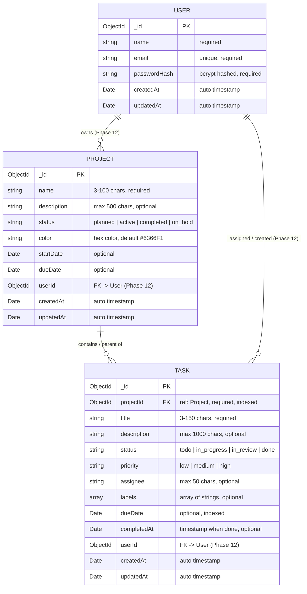

# Database Design & MongoDB Schema Specification
## SprintDesk — Project & Sprint Management Web Application

---

## 1. Database Overview

SprintDesk utilizes **MongoDB Atlas** (cloud-hosted document database) paired with the **Mongoose 9 ODM** (Object Data Modeling) library on Node.js 22 LTS.

### 1.1 Architecture & Integrity Strategy
- **Document Model**: JSON-like BSON documents allowing flexible schema definitions while enforcing structural validation via Mongoose.
- **Referential Integrity**: Uses normalized document references (`ObjectId` references) rather than embedded arrays for task collections, guaranteeing scalable pagination, independent task lifecycles, and protection against MongoDB's 16MB document size limit.
- **Connection Configuration**: Managed via a singleton Mongoose connection pool in `server/src/config/db.js` with auto-reconnect listeners.
- **Defense in Depth**: Data integrity is enforced through two complementary layers:
  1. *Request Boundary*: Zod schemas intercept and reject invalid input payloads before controller dispatch.
  2. *Data Persistence Boundary*: Mongoose schema constraints, enums, pre-save hooks, and indexes guarantee persistent data consistency.

---

## 2. Entity Relationship Model (ERD)



### 2.1 References vs. Embedded Documents
Tasks are maintained as an independent collection (`tasks`) referencing `projectId` rather than embedded documents within the `projects` collection:
- **Scalability**: Projects with hundreds of sprint tasks do not risk exceeding the 16MB BSON document boundary.
- **Query Flexibility**: Cross-project task views (e.g., global `/tasks` list, overdue alerts across all projects) require simple indexed queries on the `tasks` collection.
- **Atomic Operations**: Updating an individual task status does not require locking or rewriting the entire parent project document.

---

## 3. Project Schema Specification

### 3.1 Field Definitions & Constraints

```javascript
// server/src/models/Project.js
import mongoose from 'mongoose';

const projectSchema = new mongoose.Schema(
  {
    name: {
      type: String,
      required: [true, 'Project name is required'],
      trim: true,
      minlength: [3, 'Project name must be at least 3 characters long'],
      maxlength: [100, 'Project name cannot exceed 100 characters'],
    },
    description: {
      type: String,
      trim: true,
      maxlength: [500, 'Description cannot exceed 500 characters'],
      default: '',
    },
    status: {
      type: String,
      enum: {
        values: ['planned', 'active', 'completed', 'on_hold'],
        message: '{VALUE} is not a valid project status',
      },
      default: 'active',
      index: true,
    },
    color: {
      type: String,
      trim: true,
      match: [/^#([A-Fa-f0-9]{6}|[A-Fa-f0-9]{3})$/, 'Color must be a valid hex code'],
      default: '#6366F1',
    },
    startDate: {
      type: Date,
      default: null,
    },
    dueDate: {
      type: Date,
      default: null,
    },
    // Future Phase 12 Authentication & Tenant Scoping
    userId: {
      type: mongoose.Schema.Types.ObjectId,
      ref: 'User',
      default: null,
      index: true,
    },
  },
  {
    timestamps: true,
    toJSON: { virtuals: true },
    toObject: { virtuals: true },
  }
);
```

### 3.2 Field Analysis for Assessment
- `name` *(Required)*: Primary identifier in UI navigation.
- `status` *(Required, default `active`)*: Drives workspace filtering and active counts.
- `color` *(Optional, default `#6366F1`)*: Visual indicator on cards and details header.
- `startDate` & `dueDate` *(Optional)*: Milestone tracking.
- `userId` *(Phase 12)*: Populated when authentication is active.

---

## 4. Task Schema Specification

### 4.1 Field Definitions & Constraints

```javascript
// server/src/models/Task.js
import mongoose from 'mongoose';

const taskSchema = new mongoose.Schema(
  {
    title: {
      type: String,
      required: [true, 'Task title is required'],
      trim: true,
      minlength: [3, 'Task title must be at least 3 characters long'],
      maxlength: [150, 'Task title cannot exceed 150 characters'],
    },
    description: {
      type: String,
      trim: true,
      maxlength: [1000, 'Description cannot exceed 1000 characters'],
      default: '',
    },
    projectId: {
      type: mongoose.Schema.Types.ObjectId,
      ref: 'Project',
      required: [true, 'Task must be linked to a valid project'],
      index: true,
    },
    status: {
      type: String,
      enum: {
        values: ['todo', 'in_progress', 'in_review', 'done'],
        message: '{VALUE} is not an approved task status',
      },
      default: 'todo',
      index: true,
    },
    priority: {
      type: String,
      enum: {
        values: ['low', 'medium', 'high'],
        message: '{VALUE} is not an approved task priority',
      },
      default: 'medium',
      index: true,
    },
    assignee: {
      type: String,
      trim: true,
      maxlength: [50, 'Assignee name cannot exceed 50 characters'],
      default: '',
    },
    labels: {
      type: [String],
      default: [],
    },
    dueDate: {
      type: Date,
      default: null,
      index: true,
    },
    completedAt: {
      type: Date,
      default: null,
    },
    // Future Phase 12 Authentication & Tenant Scoping
    userId: {
      type: mongoose.Schema.Types.ObjectId,
      ref: 'User',
      default: null,
      index: true,
    },
  },
  {
    timestamps: true,
    toJSON: { virtuals: true },
    toObject: { virtuals: true },
  }
);
```

### 4.2 Lifecycle Pre-Save Hook for `completedAt`
```javascript
taskSchema.pre('save', function (next) {
  if (this.isModified('status')) {
    if (this.status === 'done' && !this.completedAt) {
      this.completedAt = new Date();
    } else if (this.status !== 'done') {
      this.completedAt = null;
    }
  }
  next();
});
```

### 4.3 Enumeration & Label Mappings

| Entity | Schema Value | Display Label in UI | Visual Style (Tailwind) |
| :--- | :--- | :--- | :--- |
| **Task Status** | `todo` | To Do | Gray / Slate badge |
| **Task Status** | `in_progress` | In Progress | Blue badge |
| **Task Status** | `in_review` | In Review | Amber badge |
| **Task Status** | `done` | Done | Emerald badge |
| **Task Priority** | `low` | Low | Slate / Muted badge |
| **Task Priority** | `medium` | Medium | Blue badge |
| **Task Priority** | `high` | High | Red badge |
| **Project Status**| `planned` | Planned | Slate badge |
| **Project Status**| `active` | Active | Indigo badge |
| **Project Status**| `completed` | Completed | Emerald badge |
| **Project Status**| `on_hold` | On Hold | Amber badge |

---

## 5. Indexing Strategy

Indexes are created to optimize query performance while avoiding unnecessary write overhead.

| Collection | Index Fields | Index Type | Target Query Pattern |
| :--- | :--- | :--- | :--- |
| `projects` | `{ createdAt: -1 }` | Single-field | Default recency sorting for project listing |
| `projects` | `{ status: 1 }` | Single-field | Filtering projects by status |
| `projects` | `{ userId: 1, createdAt: -1 }` | Compound (Phase 12)| Tenant-isolated project listing |
| `tasks` | `{ projectId: 1, status: 1 }` | Compound | Fetching tasks by project and filtering by status |
| `tasks` | `{ projectId: 1, createdAt: -1 }`| Compound | Fetching project tasks ordered by recency |
| `tasks` | `{ status: 1, dueDate: 1 }` | Compound | Identifying overdue tasks (`status != done`, `dueDate < now`) |
| `tasks` | `{ userId: 1, status: 1 }` | Compound (Phase 12)| Tenant-isolated dashboard aggregations |

---

## 6. Cascade Deletion Policy

To ensure data integrity and prevent orphaned tasks, SprintDesk implements an **Atomic Cascade Deletion Policy**:
1. When a client requests `DELETE /api/projects/:id?cascade=true`, the `projectService.deleteProject` function handles the cleanup.
2. The service deletes all associated tasks in a single operation:
   ```javascript
   await Task.deleteMany({ projectId });
   await Project.findByIdAndDelete(projectId);
   ```
3. If cascade is not confirmed or child tasks exist without explicit confirmation, the API returns `409 Conflict`, prompting user confirmation in the UI.

---

## 7. Common Query Patterns & Aggregations

### 7.1 Fetching Projects with Computed Task Progress
```javascript
const projects = await Project.aggregate([
  {
    $lookup: {
      from: 'tasks',
      localField: '_id',
      foreignField: 'projectId',
      as: 'tasks',
    },
  },
  {
    $addFields: {
      taskCount: { $size: '$tasks' },
      completedTaskCount: {
        $size: {
          $filter: {
            input: '$tasks',
            as: 't',
            cond: { $eq: ['$$t.status', 'done'] },
          },
        },
      },
    },
  },
  {
    $addFields: {
      progress: {
        $cond: [
          { $eq: ['$taskCount', 0] },
          0,
          { $round: [{ $multiply: [{ $divide: ['$completedTaskCount', '$taskCount'] }, 100] }] },
        ],
      },
    },
  },
  { $project: { tasks: 0 } },
  { $sort: { createdAt: -1 } },
]);
```

### 7.2 Dashboard Metrics Aggregation Pipeline
```javascript
const summary = await Task.aggregate([
  {
    $facet: {
      statusCounts: [
        { $group: { _id: '$status', count: { $sum: 1 } } },
      ],
      priorityCounts: [
        { $group: { _id: '$priority', count: { $sum: 1 } } },
      ],
      overdueTasks: [
        {
          $match: {
            dueDate: { $lt: new Date() },
            status: { $ne: 'done' },
          },
        },
        { $count: 'total' },
      ],
    },
  },
]);
```

---

## 8. Data Lifecycle and Migrations

1. **Seed Data Script (`server/src/utils/seed.js`)**: Provides initial sample projects and tasks for demonstration and testing.
2. **Development Cleanup**: Scripts to reset test collections cleanly without affecting production clusters.
3. **Schema Evolution**: New schema fields include safe default values (`default: null` or `default: ''`), ensuring backward compatibility with existing documents.

---

## 9. Future Authentication & Tenant Isolation (Phase 12)

When authentication is introduced in Phase 12:
- Both `Project` and `Task` documents store `userId` referencing the authenticated user.
- Every read, update, and delete query strictly appends `{ userId: req.user._id }` to the filter criteria.
- Client-supplied `userId` values in request bodies are ignored in favor of the verified session token.

---

## 10. Data Integrity Test Plan

| Test Case | Target Model | Test Action | Expected Result |
| :--- | :--- | :--- | :--- |
| **Required Field Validation** | `Project` | Create project without `name` | Mongoose & Zod reject with `400` |
| **Enum Boundary Check** | `Task` | Create task with status `"in_qa"` | Rejection: `{VALUE} is not an approved task status` |
| **Name Trimming** | `Project` | Create with `"   Sprint Beta   "` | Document persisted as `"Sprint Beta"` |
| **Cascade Deletion** | `Project` & `Task` | Delete project with 5 child tasks | 0 orphaned tasks remain in `tasks` collection |
| **Completed Timestamp** | `Task` | Set status to `"done"` | `completedAt` populated with current date |
| **Progress Bounds** | Computed | Project with 1 done out of 3 tasks | Returns `progress = 33` |
